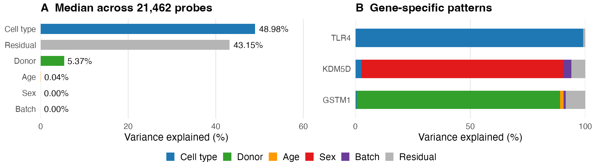

```{r setup, include = FALSE}
knitr::opts_chunk$set(echo = TRUE, message = FALSE, fig.align = "center")
```

> **In this step** we turn the per-probe variance fractions from Step 2 into
> summary tables, explore which genes are driven by each component, and make
> the two-panel summary figure.
>
> **Reads:** `results/models/*.rds` (Step 2) and `data/processed/immvar.rds` (Step 1)<br>
> **Writes:** `results/tables/variance_summary.csv`, `results/tables/marker_variance.csv`,
> `results/figures/submission_summary.{png,pdf}` and `report/summary.md`<br>
> **Run time:** under a minute

# Setup

```{r packages}
.libPaths(c("library", .libPaths()))
library(variancePartition)  # sortCols(), plotVarPart()
library(data.table)
library(ggplot2)
library(cowplot)            # combine plots into one figure
```

We use one colour per variance component throughout, so the same colour always
means the same thing.

```{r palette}
colors <- c(
  CellType = "#1F78B4", Individual = "#33A02C", Age = "#FF9900",
  Sex = "#E31A1C", Batch = "#6A3D9A", Residuals = "#B5B5B5"
)
component_names <- c(
  CellType = "Cell type", Individual = "Donor", Age = "Age",
  Sex = "Sex", Batch = "Batch", Residuals = "Residual"
)
```

# Load the results

```{r load}
data <- readRDS("data/processed/immvar.rds")
metadata   <- droplevels(data$metadata[data$metadata$included, ])
annotation <- data$annotation

combined  <- readRDS("results/models/combined.rds")  # both cell types
t_cells   <- readRDS("results/models/CD4_T.rds")     # naïve CD4 T cells only
monocytes <- readRDS("results/models/Monocyte.rds")  # monocytes only
```

# The typical probe: median variance fractions

A simple first summary is the **median** fraction of each component across
all probes. We do this for each of the three models.

```{r summarise}
summarize_model <- function(model, name) {
  data.frame(
    model          = name,
    component      = names(model),
    n_probes       = nrow(model),
    median_percent = 100 * vapply(model, median, numeric(1))
  )
}

all_summary <- rbind(
  summarize_model(combined,  "Combined"),
  summarize_model(t_cells,   "CD4_T"),
  summarize_model(monocytes, "Monocyte")
)
write.csv(all_summary, "results/tables/variance_summary.csv", row.names = FALSE)
```

The same numbers, laid out side by side (median % of variance explained):

```{r summary-wide}
component_order <- c("CellType", "Individual", "Sex", "Age", "Batch", "Residuals")

wide_summary <- dcast(as.data.table(all_summary), component ~ model,
                      value.var = "median_percent")
wide_summary <- wide_summary[match(component_order, component),
                             .(component, Combined, CD4_T, Monocyte)]
knitr::kable(wide_summary, digits = 2)
```

```{r median-helper, include = FALSE}
# Small helper for quoting medians in the text below.
median_pct <- function(model_name, component_name) {
  value <- all_summary$median_percent[all_summary$model == model_name &
                                      all_summary$component == component_name]
  sprintf("%.1f%%", value)
}
```

**How to read this.**

* **Combined model:** for the typical probe, **cell type** explains
  `r median_pct("Combined", "CellType")` of the variance and **donor**
  `r median_pct("Combined", "Individual")`. The residual is
  `r median_pct("Combined", "Residuals")`. Age, sex and batch each explain well
  under 1% for the typical probe.
* **Within-cell models:** with cell type removed, most variance is residual.
  The donor fraction is `r median_pct("CD4_T", "Individual")` in T cells and
  `r median_pct("Monocyte", "Individual")` in monocytes. As explained in
  Step 2, these within-cell donor estimates rest on a small number of repeat
  arrays, so treat them with caution.

# Beyond the median: the full distribution

A median hides a lot. The classic variancePartition plot shows a **violin** for
each component. The width of a violin shows how many probes have that fraction,
and the box marks the median and quartiles. `sortCols()` orders the components
from largest to smallest median, with residuals last.

```{r violin, fig.width = 7, fig.height = 4}
sorted <- sortCols(combined)
plotVarPart(sorted, col = colors[colnames(sorted)],
            main = "Combined model: all probes")
```

Cell type ranges from almost 0% to almost 100%. Some genes are expressed very
differently in T cells and monocytes, and others hardly differ at all. Sex,
age and batch are near zero for most probes, but a few probes stand out.

# Which probes does each component drive?

Listing the probes with the **largest** fraction for each component is a
quick way to check that the results make biological sense.

```{r top-probes}
top_probes <- function(component, n = 5) {
  top <- head(order(combined[[component]], decreasing = TRUE), n)
  ids <- rownames(combined)[top]
  data.frame(
    component = component,
    probe_id  = ids,
    symbol    = annotation$symbol[match(ids, annotation$probe_id)],
    percent   = round(100 * combined[[component]][top], 1)
  )
}

do.call(rbind, lapply(c("CellType", "Individual", "Sex", "Age", "Batch"), top_probes))
```

**What to notice:**

* **Cell type:** the top probes are classic myeloid genes, such as `S100A9` and
  `CSF3R`, that monocytes express and T cells do not.
* **Sex:** the top probes are genes on the **Y chromosome**, which only male
  donors carry.
* **Donor:** `GSTM1` leads. Many people carry no working copy of this gene, so
  its expression differs sharply between people. Several other top probes map
  to more than one gene (shown with `///`), so their gene identity is
  ambiguous.
* **Age and batch:** even the strongest probes reach only modest fractions.
  Several of the top batch probes are B-cell genes (`CD22`, `BANK1` and
  immunoglobulin heavy chains). One possible explanation is that small amounts
  of B-cell contamination in the sorted cells differed between batches. A
  pattern like this is worth noticing, but on its own it proves nothing.

# Three example probes

We pick one clear example each for cell type, sex and donor and keep their
full decomposition. We record the probe IDs explicitly because gene symbols on
arrays can be ambiguous.

```{r markers}
marker_ids <- c(TLR4 = "8157524", KDM5D = "8177232", GSTM1 = "7903765")
markers <- data.frame(
  symbol   = names(marker_ids),
  probe_id = unname(marker_ids),
  combined[unname(marker_ids), , drop = FALSE],
  check.names = FALSE
)
write.csv(markers, "results/tables/marker_variance.csv", row.names = FALSE)

knitr::kable(markers, digits = 3, row.names = FALSE)
```

| Probe | Dominant component | Why it makes sense |
|---|---|---|
| **TLR4** | Cell type | A receptor expressed by monocytes but not naïve T cells |
| **KDM5D** | Sex | Located on the Y chromosome, so only expressed in males |
| **GSTM1** | Donor | Often deleted entirely, so expression varies between people |

# The summary figure

The figure has two panels:

* **A:** the median fraction of each component across all probes (combined
  model).
* **B:** the full decomposition for the three example probes, as stacked bars
  that add up to 100%.

```{r panel-a}
combined_summary <- subset(all_summary, model == "Combined")
combined_summary$component <- factor(
  combined_summary$component,
  levels = c("Batch", "Sex", "Age", "Individual", "Residuals", "CellType")  # bottom to top
)

panel_a <- ggplot(combined_summary, aes(median_percent, component, fill = component)) +
  geom_col(width = 0.65) +
  geom_text(aes(label = sprintf("%.1f%%", median_percent)), hjust = -0.15, size = 3) +
  scale_fill_manual(values = colors, guide = "none") +
  scale_y_discrete(labels = component_names) +
  scale_x_continuous(limits = c(0, 62), breaks = c(0, 20, 40, 60)) +
  labs(title = sprintf("A  Median across %s probes",
                       format(nrow(combined), big.mark = ",")),
       x = "Variance explained (%)", y = NULL) +
  theme_minimal(base_size = 9) +
  theme(panel.grid.minor = element_blank(),
        panel.grid.major.y = element_blank())
```

For panel B, `ggplot2` needs the marker table in **long** format, with one row
per probe and component:

```{r panel-b}
marker_long <- melt(as.data.table(markers),
                    id.vars = c("symbol", "probe_id"),
                    variable.name = "component", value.name = "fraction")
marker_long$component <- factor(marker_long$component, levels = names(colors))
marker_long$symbol    <- factor(marker_long$symbol, levels = c("GSTM1", "KDM5D", "TLR4"))

panel_b <- ggplot(marker_long, aes(100 * fraction, symbol, fill = component)) +
  geom_col(width = 0.62, position = position_stack(reverse = TRUE)) +
  scale_fill_manual(values = colors, labels = component_names) +
  scale_x_continuous(breaks = c(0, 50, 100), expand = c(0, 0)) +
  coord_cartesian(xlim = c(0, 100)) +
  labs(title = "B  Examples by probe", x = "Variance explained (%)",
       y = NULL, fill = NULL) +
  theme_minimal(base_size = 9) +
  theme(panel.grid.minor = element_blank(),
        panel.grid.major.y = element_blank(),
        legend.position = "bottom") +
  guides(fill = guide_legend(nrow = 1))
```

We place the panels side by side and put panel B's legend underneath both:

```{r combine-figure}
legend <- get_legend(panel_b)
figure <- plot_grid(
  plot_grid(panel_a, panel_b + theme(legend.position = "none"),
            nrow = 1, rel_widths = c(1.05, 1)),
  legend,
  ncol = 1, rel_heights = c(1, 0.16)
)

dir.create("results/figures", recursive = TRUE, showWarnings = FALSE)
ggsave("results/figures/submission_summary.png", figure,
       width = 7, height = 2.2, dpi = 300, bg = "white")
ggsave("results/figures/submission_summary.pdf", figure,
       width = 7, height = 2.2, bg = "white")
```

This is the saved figure, exactly as written to `results/figures/`:

```{r show-figure, echo = FALSE, out.width = "100%"}

```

# Write a short text summary

Finally, we write a short Markdown summary to `report/summary.md`. All the
numbers are calculated from the results rather than typed by hand, so they stay
correct if the analysis is rerun.

```{r write-summary}
cell_median  <- median(combined$CellType) * 100
donor_median <- median(combined$Individual) * 100

dir.create("report", showWarnings = FALSE)
writeLines(c(
  "# ImmVar results",
  "",
  sprintf("The combined model was fitted to %s probes from %d arrays and %d donors.",
          format(nrow(combined), big.mark = ","),
          nrow(metadata), nlevels(metadata$Individual)),
  sprintf("Cell type explained a median %.1f%% of expression variation; donor explained %.1f%%.",
          cell_median, donor_median),
  "",
  "",
  "",
  "TLR4, KDM5D and GSTM1 illustrate cell-type, sex-associated and donor-associated patterns.",
  "Donor-associated variation is not a heritability estimate. The supplied GEO matrix has very little recorded batch-associated variation, and its complete preprocessing history is unknown."
), "report/summary.md")

cat(readLines("report/summary.md"), sep = "\n")
```

# Summary

* **Cell type** is the largest source of expression variation for the typical
  probe (`r median_pct("Combined", "CellType")`), followed by **donor**
  (`r median_pct("Combined", "Individual")`).
* Sex, age and batch matter for only a handful of probes, and the top probes
  make biological sense: Y-chromosome genes for sex, myeloid genes for cell
  type and `GSTM1` for donor.
* The figure and tables are saved in `results/`.

**Next:** open `04_check_results.Rmd` to check that the fits are trustworthy.

<details><summary>R session information</summary>

```{r session-info}
sessionInfo()
```

</details>
