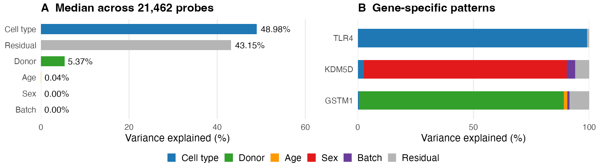

# ImmVar variancePartition

This project uses variancePartition to study gene-expression variation in naïve CD4 T cells and monocytes from the ImmVar study (GEO GSE56035).

## Run the analysis

Open **immvar.Rproj** in RStudio. Install the packages once:

~~~sh
Rscript install_packages.R
~~~

Then knit the four notebooks in order: **01_prepare_data.Rmd**, **02_fit_models.Rmd**, **03_make_figures.Rmd**, and **04_check_results.Rmd**.

To run all four from a terminal:

~~~sh
Rscript render_all.R
~~~

The notebooks download the GEO data, prepare the expression matrix, fit the models, make figures, and check the results. Model fitting is the slowest step. Saved fits can be reused; set **refit = TRUE** to run them again.

## Data and models

The analysis starts with 984 arrays and 21,727 probes. After excluding nine paired donors with conflicting recorded ages and probes containing nonpositive values, it includes 379 paired donors, 817 arrays, and 21,462 probes. The supplied RMA values are converted from linear scale to log2; no additional normalization or batch correction is applied.

The combined model is:

~~~r
~ Age + (1 | Sex) + (1 | CellType) + (1 | Batch) + (1 | Individual)
~~~

Separate models within each cell type use:

~~~r
~ Age + (1 | Sex) + (1 | Batch) + (1 | Individual)
~~~

Age is a standardized fixed effect. The other terms are random effects. Models use maximum likelihood, and variance fractions for each probe sum to one.

## Main result

Across probes, cell type explains a median 49.0% of expression variation and donor explains 5.4%. TLR4, KDM5D, and GSTM1 illustrate probes where cell type, sex, and donor account for large fractions, respectively. Donor-associated variation is not a heritability estimate. The GEO matrix shows little batch-associated variation; its full preprocessing history is unknown.

## References

- Hoffman and Schadt (2016). [variancePartition](https://doi.org/10.1186/s12859-016-1323-z).
- Raj et al. (2014). [Original ImmVar study](https://doi.org/10.1126/science.1249547).
- De Jager et al. (2015). [ImmVar overview](https://doi.org/10.1016/j.smim.2015.03.003).
